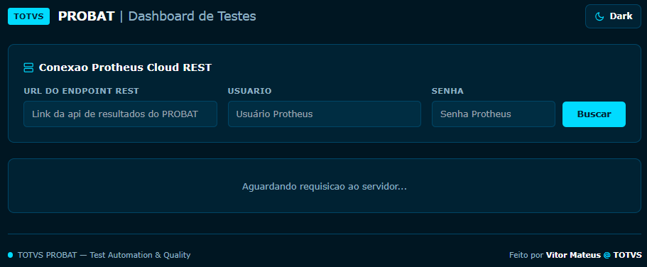

# 🤖 PROBAT Companion

> **Dashboard moderno de observabilidade, métricas e visualização de testes unitários para TOTVS Protheus (PROBAT / tlppCore).**

[](https://opensource.org/licenses/Apache-2.0)
[](https://tdn.totvs.com)
[](#)
[](#)

---

## 📸 Preview




*Interface moderna baseada no estilo da TOTVS com suporte a Light & Dark Mode nativo, métricas agregadas e inspeção detalhada de cada caso de teste.*

---

## O Contexto e a Dor Real de QA no Protheus

Escrever testes automatizados no ecossistema TOTVS Protheus historicamente enfrenta três grandes barreiras que desmotivam desenvolvedores e times de qualidade:

1. **Encontrar código testável**: Sistemas ERP carregam anos de legado, regras fortemente acopladas a banco de dados e variáveis de ambiente, tornando o isolamento de rotinas um desafio.
2. **A curva de escrita de testes**: O framework **PROBAT (`tlppCore`)** trouxe uma evolução fantástica para o mundo TLPP, mas ainda exige adaptação de mentalidade e referências práticas.
3. **A experiência de visualizar resultados**: Depois de todo o esforço para isolar e escrever o teste, a entrega de resultado era fria e trabalhosa — ficar olhando saídas brutas de console no AppServer ou abrir arquivos XML estáticos (`resultsprobat.xml`) manualmente. 

Essa fricção de consumo pós-teste muitas vezes era a gota d'água que **desencorajava a continuidade da cultura de testes**.

### A Proposta do MVP Atual
O **PROBAT Companion** nasceu para atacar diretamente essa terceira dor com **pragmatismo e zero complicação**:
- O MVP atual consome o arquivo XML da última execução (`resultsprobat.xml`) gerado pelo PROBAT e o transforma instantaneamente em uma interface rica, limpa e com feedback visual imediato.
- Você roda seus testes e enxerga na hora o que **Passou**, o que **Falhou** e o que foi **Pulado**, com Dark/Light Mode e inspeção de asserções.

> **Visão de Futuro**: Com essa barreira de visualização superada e a experiência validada, os próximos passos do projeto envolverão transformar a ferramenta em um executor completo (disparo sob demanda) e integrar consultas históricas diretamente no banco SQLite nativo do PROBAT.

---

## Recursos funcionais do MVP

- 🎨 **Adequação à Identidade Visual TOTVS**: Desenvolvido seguindo rigorosamente as a paleta oficial da TOTVS, proporcionando a sensação de um produto nativo do ecossistema.
- 🌗 **Dark Mode & Light Mode Nativos**: Alternância fluida de temas projetada para máxima ergonomia visual, alto contraste e legibilidade durante sessões de análise e debug.
- 📊 **Painel de Métricas**: Contadores em tempo real para:
  - 🟢 **Testes Aprovados**
  - 🔴 **Testes com Falha**
  - 🟡 **Testes Skippados**
  - ⏱️ **Tempo Total de Execução**
- 🔍 **Inspeção de Asserções e Erros**: Visualização detalhada do stack trace, mensagens de falha e parâmetros de validação para facilitar o debug imediato.
- ⚡ **Backend REST Nativo em TLPP**: Endpoint desacoplado (`@Get("/api/v1/probat/results")`) implementado no próprio AppServer para extrair os resultados sem ferramentas intermediárias pesadas.
- 📦 **Zero Atrito de Instalação**: Interface web pronta para abrir direto no navegador ou ser servida pela pasta web do Protheus. Para o back, basta aplicar o patch no servidor. 

---

## 🏗️ Arquitetura do Projeto

```text
┌─────────────────────────────────┐
│    PROBAT - Execução de Testes  │
└────────────────┬────────────────┘
                 │ Gera resultados
                 ▼
┌─────────────────────────────────┐
│     Backend REST (TLPP)         │
│   ProbatRestController.tlpp     │
│   GET /api/v1/probat/results    │
└────────────────┬────────────────┘
                 │ HTTP / JSON / XML
                 ▼
┌─────────────────────────────────┐
│   PROBAT Companion Frontend     │
│   Dashboard, Visualização       │
│   KPIs & Debug                  │
└─────────────────────────────────┘
```

---

## 📁 Estrutura de Diretórios

```text
PROBAT-Companion/
├── back/
│   └── src/
│       └── ProbatRestController.tlpp  
├── front/
│   └── probat_dashboard.html          
├── docs/
│   ├── esboço inicial.excalidraw      
│   └── preview.png                    
├── LICENSE
└── README.md
```

---

## 🚀 Como Executar

### 1. Backend (Protheus / AppServer)
1. Certifique-se de que o **TLPP Core** e o suporte a REST por anotações estejam habilitados no seu ambiente.
2. Compile o fonte [`back/src/ProbatRestController.tlpp`](back/src/ProbatRestController.tlpp) no seu repositório.
3. Após a execução da sua suíte de testes PROBAT, o endpoint estará acessível em:
   ```http
   GET http://<seu-appserver>:<porta-rest>/api/v1/probat/results
   ```

### 2. Frontend (Dashboard)
1. Navegue até a pasta `front/`.
2. Abra o arquivo [`probat_dashboard.html`](front/probat_dashboard.html) diretamente no seu navegador.
3. Configure o endereço do seu servidor REST, usuário e senha do protheus na interface e clique em "Carregar Resultados".

---

## 🗺️ Roadmap de Evolução

- [x] MVP funcional com suporte a Dark/Light Mode e leitura de resultados.
- [x] Métricas agregadas (Pass, Fail, Skip, Duração).
- [ ] Leitura direta e consultas otimizadas no banco **SQLite nativo do PROBAT** (21 tabelas estruturadas com histórico de execuções e Code Coverage).
- [ ] Endpoint `POST /api/v1/probat/run` para disparo de testes sob demanda direto pelo dashboard.
- [ ] Componentização do frontend com **Angular + PO UI** para ecossistema corporativo.

---

## 🤝 Contribuições

Contribuições, sugestões e feedbacks são muito bem-vindos! Sinta-se à vontade para abrir uma *Issue* ou enviar um *Pull Request*.

---

## 📄 Licença

Distribuído sob a licença [Apache 2.0](LICENSE).
